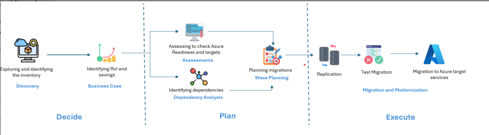

# Microsoft Azure

## Core Azure Architecture
- ### Azure regions
  A set of Microsoft data centers deployed within a specific geographic area.
  - Pairs regions
  - unpair regions
  - Sovereign regions (Governments)
- ### Availability Zone
  Physical and logically separated datacenter location withn a Microsoft Azure region.

- ### Three types of Azure Services
  - Zonal Services - VM. You have the option to select avaliability zone.
  - Zone-redundant Service - Azure SQL Database. It automatically redeploy to other availability zones. You do nit have to choose.
  - Always Available Services - Azure Portal, Ente ID, Azure front Door. These are global resources

- ### Resources and Resources groups
Microsoft Azure resources are Azure services that you create and deploy in Microsoft Azure. E.G Virtual machine, Storage Account, or database etc. An Azure resource group is a logical container that holds related resources for a Microsoft Azure solution.

- ### Subscriptions
Subscription is a billing unit within Microsoft Azure.
  #### Types of subscriptions
  - Free plan - $200 credits for irdt 30 days
  - Pay as you Go - Billed to credit card
  - Enterprise Agreement - EA
  - Free credits - MSDN, startup plan

### Azure Management groups
They allow organizations to manage access, policies, and compliance across multiple subscriptions simultaneously. 

The hierachy is Management group -> subscriptions -> Resources group -> resources.

## Azure Compute Services
Azure compute services is the technical pillars of Azure.
- Compute services
  - Virtual Machine (VM)
  - VM Scale Sets (VMSS) - A group of VMs that can grow and shrink in quantity based on apredefined rule.

  _Azure availability set and proximity placement groups (PPGS)_ are both logical grouping feature for VMs for different primary goals. 
  - APP Services (Web apps)
  - Azure Container Instance (ACI)
  - Azure Container App
  - Azure Kubernetes Service (AKS)
  - Azure Virtual Desktop
  - etc
- networking services
- Storage services
- Database services

## Azure Function
Is an event-driven compute service by Microsoft that lets you run small piece of code (called function) witout managing underlying infrastructure. It is triggered by some happening likeHTTP call, Timer, blob creation, message queue etc. The hosting plan includes
- Flex consumption plan: recommended for pay-as-you-go
- Azure container App plan: Runs functions inside containerized environments
- Premium plan: Provides pre-warned instances to avoid cold start and virtual network connectivity
- App service plan: Runs funstion on traditional dedivated app service infrastructure
- Fre Grant - Upto 1million free executions per month on consumption tier

## Azure Networking Services - VNet
VNet is the foundamental building block for private cloud infrastrucrure in Azure. 
- _Azure Private links_ connects your VNet to Azire PaaS or custom services privately over the microsoft backbone.
- _Azure DNS_: Provides domain hosting, private DNS zones for virtual networks, and private resolutiuon
- _Azure Bastion_: Delivers secure browser-based RDP and SSH access to VMs without public IP addresses.
- _Azure Route Server_: simplifies dynamic routing between Network Virtual Appliances (NVAS) and Azure networks using BGP
- _Azure NAT Gateway_: Manages outbound-only internet connectivity for subnets while hiding private IPs
- _Azure Traffic Manager_: A DNS -based global traffic load balancer
- _Peering_: to connecting two vnsts together to allow communication between a VM on one network and a VM on a different network.
- _Azure VPN Gateway_: vitrual private networking that allow communication between a workstation and a network, or between two networks.

## Azure storage
Azure Storage is an Infrastructure as a Service (IaaS). Divided into four types of data it can store
  - Container
  - File
  - Queue
  - Table
### Types of Azure Storage Services
- Container (Azure blob) storage: Object storage for massive amounts of unstructured data like text, binary files, media, and data lakes.
- Azure Disk storage - for Virtual Hard Disks (VHDs):  Block-level storage volumes (managed disks) for Azure Virtual Machines
- Azure File Storage:  Serverless cloud file shares accessed via standard SMB and NFS protocols.
- Azure Queue Storage:  Message storage for small messages enabling reliable, asynchronous communication between application components.
- Azure table storage:  A NoSQL store for semi-structured, schema-less data.

### Storage Access tiers
- Hot: the default, balanced access
- Cool: Cheaper storage with more expensive read/write operations
- Cold: Much cheaper storage, more expensive read/write operations
- Archive: Cannot immediately access the files, cheapest storage, most expensive operations

You can access Azure storage using
- Storage explorer
- Storage browser

### AZCopy
Is a command-line utility from Microsoft designed to copy data to, from, or between Azure Storage accounts
```
azcopy copy 'source_path' 'destination_path'
```

## Azure migrate
Is a centralized hub service by Microsoft designed to discover, assess, and migrate on-premises or multi-cloud infrastructure, databases, web applications, and virtual desktops to Microsoft Azure.
### Migration Phases
- Decide (Discovery)
- Plan
- Execute



## Identity, Access, and Security
- Entra ID formerly called Azure active Directory: Entra ID used SAML, OpenID, and Oauth protocols, while Active Directory used LDAP and kerberos protocol for communication.
  - external identity (B2B-Bsiness 2 Business and B2C - Bsiness 2 Consumer for application ens users)
  - Entra Conditional Access
  - Role based access control - RBAC: (Reader, contributor and owner)
  - Single sign on
  - Passwordless
  - MFA

## Azure monitoring tools
- Azure Advisor
- Azure service health
- Azure monitor centralized dashboard
- Azure monitor report